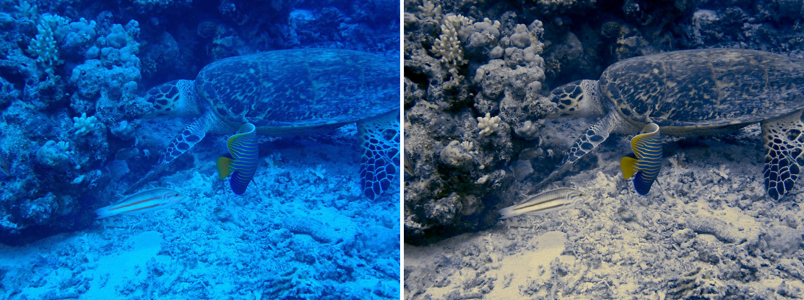
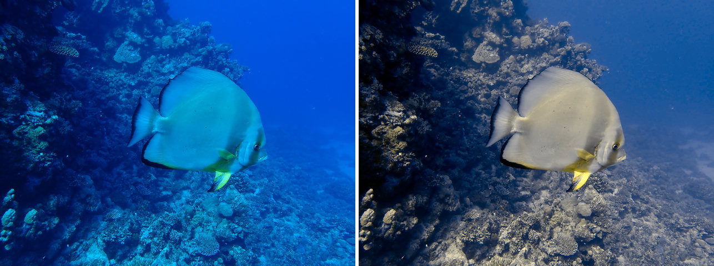
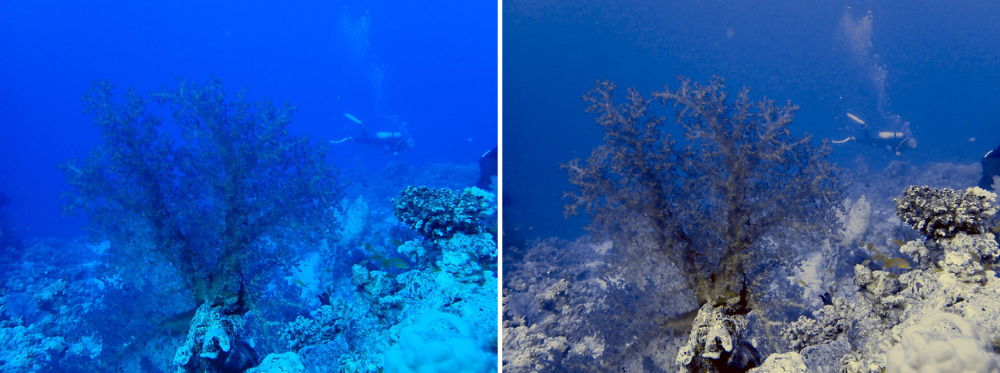
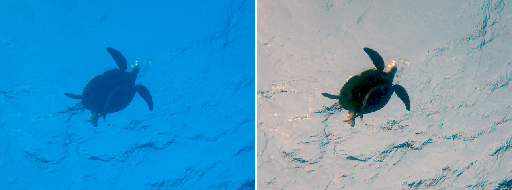
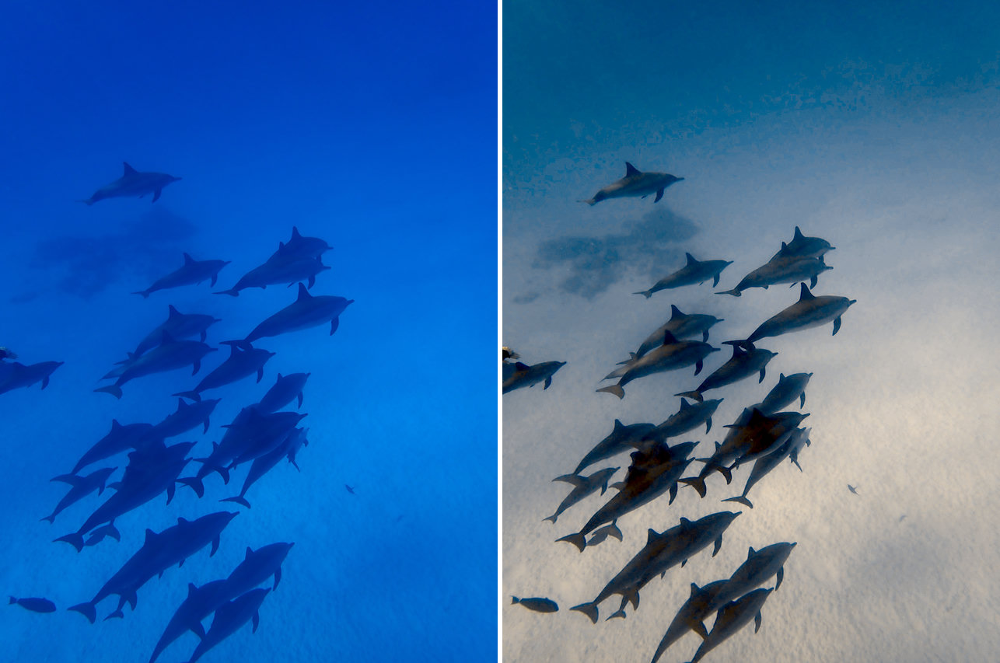

# UWCC — UnderWater Color Correction

Water absorbs red light first, so underwater photos and videos come out
blue-green, flat and hazy. UWCC brings the colour back with one tap and offers
manual controls for fine-tuning. It is one codebase for the web, iOS and
Android.

**Try it:** https://newkit.github.io/UWCC/

Everything runs on your device. There is no account, no upload, no backend
and no analytics, and the web app keeps working offline once it has loaded.

## Examples

Original on the left, UWCC's automatic correction on the right, with no
manual adjustments.











The images are rendered from the originals in `testdata/photos/` by
`core/examples/before_after.rs`
(`cargo run --release --example before_after -- ../docs/images ../testdata/photos/turtle_before.jpg ...` in `core/`).

## Features

- Automatic correction of photos (JPEG, PNG, HEIC where the platform decodes
  it) and videos (MP4/MOV, H.264, HEVC where supported). Video is analysed
  every second or two, so the correction follows changes in depth and light.
- Manual controls with a live preview: correction strength, temperature,
  tint, exposure, contrast, saturation and vibrance, plus a neutral picker.
- Colour modes (Natural, Vivid, Deep, Soft, Warm, Cool, Black & white) that
  set the sliders to named positions.
- Before/after: press and hold, or drag the split view.
- Several correction methods to compare: UWCC's own (the default), a
  hue-shift matrix, Ancuti white balance and fusion, Sea-thru (estimated range
  or depth model) and UDCP haze removal.
- Batch runs over a mixed selection of photos and videos, with progress, a
  summary, and per-item adjustments.
- Full-resolution export: photos as JPEG with EXIF kept; videos as MP4 at
  source resolution and frame rate with the original audio.
- Edits are non-destructive. Results are written next to the original (or
  downloaded; on iPhone and iPad saved to Photos). The original is only
  replaced if you turn that setting on. Files UWCC already corrected are
  recognised and skipped.

## How it works

Every correction method only computes a small set of parameters. One shared
per-pixel pipeline applies them: a WebGL2 shader in the browser for preview
and export, and a Rust reference implementation that the shader is checked
against. Video is decoded, shaded and re-encoded frame by frame with
WebCodecs and streamed to a temporary file, so memory use does not grow with
clip length.

`SPECIFICATION.md` is the source of truth for scope, the algorithm, the
architecture and the milestone status.

## Repository layout

| Path | Contents |
|------|----------|
| `core/` | Rust crate `uwcc-core`: parameter model, CPU reference, the correction methods, WASM bindings |
| `web/` | The app: React, TypeScript, Vite, WebGL2, WebCodecs |
| `spike/m0/` | Throwaway device test page for milestone M0 |
| `testdata/photos/` | Before/after reference pairs used by the core's regression tests and as in-app samples |
| `docs/images/` | The README examples |

## Building

Requirements: Rust via rustup (`rust-toolchain.toml` pins the toolchain and
the `wasm32-unknown-unknown` target) and Node.js with npm.

```sh
# Core: unit tests and reference-image regression tests
cd core
cargo test
cargo test --test reference_images -- --nocapture   # prints the error per pair

# App
cd web
npm install
npm run dev      # builds the core to WASM, then starts Vite
npm run build    # production build in web/dist/
```

`npm run dev` and `npm run build` also fetch the depth model used by one of
the Sea-thru variants into `web/public/models/` (pinned and hash-checked; not
committed).

To check the shader against the Rust reference, run
`await window.uwccSelfTest()` in the browser console of the running app. It
returns the largest per-channel difference (0–255); expect 0 or 1.

CI (`.github/workflows/ci.yml`) runs the core checks, builds the app and
deploys it to GitHub Pages on every push to `main`. The version shown in the
app is the package version plus the commit id, e.g. `0.1.0+b3f5c66`.

## Status

The web app is usable today. Mobile packaging with Capacitor is planned and
depends on the device spike (M0); see `SPECIFICATION.md` §9.

## Licence

Dual-licensed under either of

- MIT licence (`LICENSE-MIT`)
- Apache License, Version 2.0 (`LICENSE-APACHE`)

at your option.
